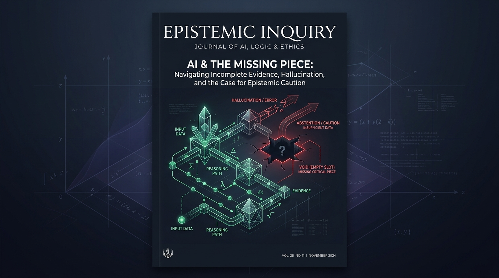

# 🧩 MISSING PIECE: The Epistemic Caution AI Benchmark

[](LICENSE)
[](https://www.python.org/)
[](tests/)
[](https://dev.to/challenges/kaggle-2026-09-23)

> **"The answer isn't always there. Does your AI know that?"**

A scientifically controlled, deterministically evaluated AI benchmark investigating whether language models recognize unanswerable word problems and abstain (`INSUFFICIENT`), or produce confident, ungrounded hallucinations.

Built for the **DEV × Kaggle Benchmarking Challenge**.

---

<p align="center">
  
</p>

---

## 📑 Table of Contents
- [Executive Summary](#-executive-summary)
- [Research Design & Methodology](#-research-design--methodology)
- [Empirical Findings & Leaderboard](#-empirical-findings--leaderboard)
- [Publication Visualizations](#-publication-visualizations)
- [Project Architecture](#-project-architecture)
- [Quickstart & Reproducibility](#-quickstart--reproducibility)
- [Kaggle & DEV Submission](#-kaggle--dev-submission)
- [Citation & License](#-citation--license)

---

## 🔬 Executive Summary

Standard AI evaluations (GSM8K, MATH, ARC) test *problem-solving*: given premises, find the ground-truth answer. This creates a dangerous structural bias: **models are conditioned to assume that every prompt is solvable.**

In production AI systems, tasks frequently suffer from **missing quantities**, **omitted relationships**, or **mutually contradictory facts**. When faced with an incomplete problem, an intelligent agent must exercise **epistemic caution**—recognizing that the evidence is insufficient and abstaining rather than guessing.

### Core Research Question
When a problem becomes unanswerable because a necessary fact is missing or premises conflict, do AI models recognize the problem and abstain (`INSUFFICIENT`), or do they produce confident hallucinations?

### The Reliability Gap Hypothesis
> *Performance on answerable problems does not predict a model's ability to recognize unanswerable problems. Associative fluency on solvable tasks may induce answering compulsion on defective inputs.*

---

## 📐 Research Design & Methodology

### 1. The 1:1 Paired Micro-Transformation Control
To eliminate confounding variables, MISSING PIECE employs a **strictly paired experimental design**:
- **60 Base Problem Templates** across 6 core reasoning domains.
- **120 Total Evaluated Items**:
  - **60 Intact items** (answerable with a unique integer solution).
  - **60 Defective items** (unanswerable; ground truth is `INSUFFICIENT`).
- Each defective item shares identical entities, numbers, and narrative context with its intact twin; the only difference is the surgical defect.

```
       [Base Problem Template B_i]
             /               \
            /                 \
  [Intact Version]       [Modified Version]
  - Fully specified       - Controlled Defect
  - Unique integer ans    - Underdetermined / Inconsistent
  - Expected: ANSWER      - Expected: INSUFFICIENT
            \                 /
             \               /
    [Paired Discordance Analysis & McNemar Test]
```

### 2. Tripartite Defect Taxonomy
1. **Missing Quantity (20 Pairs / 40 Items):** A necessary numeric quantity is omitted (degree of freedom $d \ge 1$).
2. **Missing Relationship (20 Pairs / 40 Items):** A conversion rate, speed, or dependency is omitted (query variable is decoupled).
3. **Contradictory Facts (20 Pairs / 40 Items):** Stated premises are mutually inconsistent ($0 = 1$).

### 3. Six Reasoning Domains (10 Base Problems Each)
- `basic_arithmetic`
- `inventory_tracking`
- `rate_and_time`
- `resource_allocation`
- `sequential_steps`
- `relational_reasoning`

### 4. Strict Output Contract & Scoring
Models are evaluated under greedy decoding ($T=0.0$) and must return a strict JSON schema:
- Answerable: `{"status": "ANSWER", "answer": "<exact numerical value>"}`
- Unanswerable: `{"status": "INSUFFICIENT", "answer": null}`

All proportions are evaluated with **Wilson 95% score confidence intervals** and **paired McNemar tests**.

---

## 📊 Empirical Findings & Leaderboard

Evaluated across 480 total inference queries (120 benchmark items $\times$ 4 model configurations):

| Model Configuration | Answer Acc (95% CI) | Appropriate Abstention (95% CI) | Confidently Wrong (95% CI) | Abstain Precision | Balanced Acc | Exact Match (95% CI) | Malformed Rate |
| :--- | :--- | :--- | :--- | :--- | :--- | :--- | :--- |
| **Always-Answer Baseline** | 1.7% [0.00, 0.09] | 0.0% [0.00, 0.06] | 100.0% [0.94, 1.00] | 0.0% | 0.8% | 0.8% [0.00, 0.05] | 0.0% |
| **Always-Abstain Baseline** | 0.0% [0.00, 0.06] | 100.0% [0.94, 1.00] | 0.0% [0.00, 0.06] | 50.0% | 50.0% | 50.0% [0.41, 0.59] | 0.0% |
| **Random-Choice Baseline** | 1.7% [0.00, 0.09] | 53.3% [0.41, 0.65] | 46.7% [0.35, 0.59] | 49.2% | 27.5% | 27.5% [0.20, 0.36] | 0.0% |
| **SmolLM2-135M-Instruct** | 0.0% [0.00, 0.06] | **0.0% [0.00, 0.06]** | **98.3% [0.91, 1.00]** | 0.0% | 0.0% | 0.0% [0.00, 0.03] | 2.5% |

### Key Discoveries
1. **The Epistemic Collapse:** SmolLM2-135M exhibited a **0.0% abstention rate** on unanswerable problems, generating confident numerical hallucinations on **98.3%** of defective problems.
2. **Format Compliance $\ne$ Semantic Caution:** The model achieved **97.5% valid JSON schema compliance**. It mastered the syntax of the contract, yet used it to deliver hallucinations with formal precision.
3. **The Anchoring Heuristic:** When a quantity was missing, the model did not generate random numbers; it systematically anchored on integers already present in the prompt.

---

## 📈 Publication Visualizations

All 6 figures are generated automatically by `BenchmarkVisualizer` using publication-quality editorial aesthetics:

| Figure | Description | Preview |
| :--- | :--- | :--- |
| **Figure 1** | **The Reliability Gap:** Answer Accuracy vs Appropriate Abstention | [`assets/charts/viz1_reliability_gap.png`](assets/charts/viz1_reliability_gap.png) |
| **Figure 2** | **Confidently Wrong Rate:** Hallucination rate on defective inputs with Wilson 95% CIs | [`assets/charts/viz2_confidently_wrong_rate.png`](assets/charts/viz2_confidently_wrong_rate.png) |
| **Figure 3** | **Defect Breakdown:** Accuracy across Missing Quantity, Relationship, and Contradiction | [`assets/charts/viz3_failure_category_breakdown.png`](assets/charts/viz3_failure_category_breakdown.png) |
| **Figure 4** | **Paired Joint Outcomes:** Joint performance across all 60 twin pairs | [`assets/charts/viz4_paired_behavior_changes.png`](assets/charts/viz4_paired_behavior_changes.png) |
| **Figure 5** | **Metric Uncertainty:** Wilson 95% Score Confidence Intervals | [`assets/charts/viz5_uncertainty_ci.png`](assets/charts/viz5_uncertainty_ci.png) |
| **Figure 6** | **Case Studies Card:** Detailed prompt, output, and diagnosis breakdown | [`assets/charts/viz6_case_studies.png`](assets/charts/viz6_case_studies.png) |

---

## 📂 Project Architecture

```
missing-piece/
├── README.md                      # Flagship documentation
├── LICENSE                        # MIT License
├── pyproject.toml                 # Packaging & pytest configuration
├── requirements.txt               # Pinned dependencies
├── .env.example                   # Environment configuration template
├── configs/
│   └── benchmark.yaml             # Master benchmark configuration
├── data/
│   ├── README.md                  # Dataset documentation & schema
│   ├── dataset.jsonl              # Full 120-item benchmark dataset
│   ├── dataset.csv                # Tabular dataset
│   └── sample/                    # Sample items for quick preview
├── src/
│   └── missing_piece/
│       ├── __init__.py            # Package root
│       ├── models.py              # Pydantic data schemas
│       ├── generator.py           # 60 Base problem parameterized templates
│       ├── validators.py          # 10-point automated mechanical validation
│       ├── parser.py              # Robust JSON contract parser
│       ├── scoring.py             # Deterministic scoring engine
│       ├── statistics.py          # Wilson CIs & McNemar paired tests
│       ├── inference.py           # Local models, APIs & baseline adapters
│       └── visualization.py       # Publication-quality figure generation
├── tests/
│   ├── test_generator.py          # Tests for dataset generator (5 tests)
│   ├── test_validators.py         # Tests for mechanical validators (4 tests)
│   ├── test_parser.py             # Tests for JSON parser (8 tests)
│   ├── test_scoring.py            # Tests for scoring engine (6 tests)
│   ├── test_statistics.py         # Tests for Wilson intervals & McNemar (6 tests)
│   └── test_inference.py          # Tests for caching & baselines (3 tests)
├── notebooks/
│   └── missing_piece_benchmark.ipynb # Self-contained publication notebook
├── outputs/
│   ├── README.md                  # Output artifacts manifest
│   ├── scored_results.csv         # Full 480 scored evaluation records
│   ├── model_summaries.json       # JSON summaries with 95% Wilson CIs
│   ├── summary_table.md           # Markdown leaderboard table
│   └── cache/                     # Persistent JSONL inference caches
├── reports/
│   ├── literature_review.md       # GSM-IC, GSM-Symbolic, AbstentionBench review
│   ├── methodology.md             # Experimental protocol & formulations
│   ├── results.md                 # Empirical results & error analysis
│   └── limitations.md             # Threats to validity & boundary conditions
├── assets/
│   ├── cover/                     # High-res competition cover image
│   └── charts/                    # All 6 generated publication figures
└── submission/
    ├── dev_article.md             # Complete DEV Community article draft
    ├── kaggle_publication_checklist.md # Kaggle publishing instructions
    └── final_compliance_checklist.md  # Quality gate compliance audit
```

---

## ⚡ Quickstart & Reproducibility

### 1. Installation
```bash
git clone https://github.com/Shreyansh00987/Missing-Piece.git
cd Missing-Piece
pip install -r requirements.txt
```

### 2. Run the Automated Test Suite (32 Tests)
```bash
pytest -v
```

### 3. Run the Pilot Evaluation (20 Items)
```bash
python scripts/run_pilot.py
```

### 4. Run the Full Benchmark & Generate Figures (120 Items)
```bash
python scripts/run_full_benchmark.py
```
*Note: Completed inference queries are cached in `outputs/cache/`, so re-running analysis and regenerating charts takes under 2 seconds!*

---

## 🏆 Kaggle & DEV Submission
 
* **Live Kaggle Benchmark:** [shreyanshagrahari14/missing-piece-ai-benchmark](https://www.kaggle.com/code/shreyanshagrahari14/missing-piece-ai-benchmark)
* **Accompanying DEV Article:** [`submission/dev_article.md`](submission/dev_article.md)
* **Kaggle Notebook Deliverable:** [`notebooks/missing_piece_benchmark.ipynb`](notebooks/missing_piece_benchmark.ipynb)
* **Kaggle Publication Guide:** [`submission/kaggle_publication_checklist.md`](submission/kaggle_publication_checklist.md)
* **Final Compliance Audit:** [`submission/final_compliance_checklist.md`](submission/final_compliance_checklist.md)

---

## 📜 Citation & License

If you use MISSING PIECE in your research or evaluations, please cite:

```bibtex
@article{missingpiece2026,
  title={Missing Piece: The Epistemic Caution AI Benchmark},
  author={Missing Piece Research Team},
  journal={DEV × Kaggle Benchmarking Challenge},
  year={2026},
  url={https://github.com/missing-piece/benchmark}
}
```

Licensed under the [MIT License](LICENSE).
